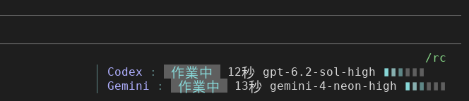

<a id="readme-top"></a>

<div align="center">

<h1>codex-gemini-status</h1>

<p>
  <b>Codex と Gemini が、いま動いているかが分かる。</b><br>
  Claude Code のステータス行に、Codex CLI と Antigravity CLI（Gemini）の動作状況とモデル名を出す mod です。
</p>

[![Claude Code][claude-shield]][claude-url]
[![TypeScript][ts-shield]][ts-url]
[![Platform][platform-shield]](#前提)
[![Version][version-shield]](.claude-plugin/plugin.json)
[![MIT License][license-shield]](LICENSE)



<p>
  <a href="#導入">導入</a>
  ·
  <a href="#使い方">使い方</a>
  ·
  <a href="https://github.com/takamiya1021/codex-gemini-status/issues">不具合の報告・要望</a>
</p>

</div>

> **English summary** — A Claude Code mod that shows, at the right end of the status line, whether Codex CLI (`codex exec`) and Antigravity CLI (`agy -p`) are currently running, with the model each one uses. It reads `ps` every 5 seconds, groups the processes of one run by their parent–child relationship, and shows nothing when neither is running. Linux (including WSL2) only. UI text is in Japanese.

<details>
<summary><b>目次</b></summary>

- [この mod について](#この-mod-について)
- [前提](#前提)
- [導入](#導入)
- [使い方](#使い方)
- [何を「作業中」と数えるか](#何を作業中と数えるか)
- [モデル名の取り方](#モデル名の取り方)
- [注意](#注意)
- [開発](#開発)
- [不具合の報告・要望](#不具合の報告要望)
- [利用条件](#利用条件)

</details>

## この mod について

Claude Code から Codex や Gemini に仕事を頼むと、頼んだ先が今も動いているのか、もう終わったのかが画面から分かりません。この mod を入れると、**動いている間だけ 1 行が出て、終わると消えます**。

- **自動で出て、自動で消える** — 設定はありません。何も動いていない時は何も出しません
- **モデル名つき** — 起動時の引数か設定ファイルから、使っているモデルを読みます
- **どこから起動しても見える** — Claude Code から頼んだもの、スクリプトから呼んだもの、ターミナルで直接打ったもの、どれも同じに数えます
- **何本動いているかも分かる** — 同じ CLI が同時に動いていれば `×2` のように本数が付きます
- **読むだけ** — 依頼文の表示・保存、ファイルへの書き込み、ネットワーク通信はしません

<p align="right">(<a href="#readme-top">先頭へ</a>)</p>

## 前提

| 要るもの | 無いとどうなるか |
|---|---|
| **Claude Code**（mod＝フックモジュールのプラグインが使える版。2.1.330 で確認。これより古い版では試していません） | 入れられません |
| **Linux**（WSL2 を含む）。`ps -eo pid=,ppid=,etimes=,args=` が動くこと（procps の ps）と `/proc` | macOS では `ps` に `etimes` が無いため、何も表示されません |
| **Codex CLI**（`codex`。0.170.0 で確認） | Codex の行が出ないだけです |
| **Antigravity CLI**（`agy`。1.5.14 で確認） | Gemini の行が出ないだけです |

Codex CLI と Antigravity CLI は、使う方だけ入っていれば大丈夫です。この mod は CLI を起動しません。ほかの方法で起動されたものを見るだけです。

## 導入

Claude Code のターミナルの入力欄で:

```
/plugin install codex-gemini-status --marketplace takamiya1021/codex-gemini-status
```

`Add marketplace?` と聞かれたら `y`、入れる範囲（scope）は user のまま Enter で入ります。入れたセッションからすぐ動き、user に入れた場合は以後のセッションでも動きます。

<details>
<summary>シェルから入れる・デスクトップアプリで入れる・外す</summary>

シェルからなら:

```bash
claude plugin install codex-gemini-status --marketplace takamiya1021/codex-gemini-status
```

デスクトップアプリでは `/plugin` が動かないので、入力欄の横の + → Plugins → Add marketplace に `takamiya1021/codex-gemini-status` を入れ、Add plugin で入れます。

外す時は:

```
/plugin uninstall codex-gemini-status
```

</details>

<p align="right">(<a href="#readme-top">先頭へ</a>)</p>

## 使い方

入れるだけで動きます。Codex か Gemini が動いている間だけ、ステータス行の右端に 1 行ずつ出ます。

```
│ Codex  :  作業中  12秒 gpt-6.2-sol-high    ▮▮▮▮▮▮
│ Gemini :  作業中  13秒 gemini-4-neon-high  ▮▮▮▮▮▮
          状態      経過   モデル名            動いている間、光の粒が行き来する
```

- 同じ CLI が同時に何本も動いている時は、経過時間の後ろに `×2` のように本数が付きます。経過時間は一番長く動いているものです。

| コマンド | すること |
|---|---|
| `/cgstatus` | 今の状況を文字で返します。表示を隠していた時は戻します |
| `/cgstatus hide` | 表示を隠します。もう一度 `/cgstatus` で戻ります |

<p align="right">(<a href="#readme-top">先頭へ</a>)</p>

## 何を「作業中」と数えるか

5 秒おきに `ps` を読み、**モデルに 1 回仕事をさせて終わる起動（ワンショット）だけ**を数えます。

| | 数える | 数えない |
|---|---|---|
| Codex | `codex exec ...` | `codex`（対話の画面）・`codex app-server` |
| Gemini | `agy -p ...`（`--print` `--prompt` も） | `agy`（対話の画面）・IDE が常に動かしている `agy --hub` |

- **対話の画面は数えません。** 開いている間ずっと同じ処理が残り、`ps` からはモデルが考えている最中か入力を待っているだけかを見分けられないためです。数えると、開いている間ずっと「作業中」になります。
- **1 回の起動は 1 本に数えます。** 1 回の起動は `timeout` → `node` や `python` → 本体 のように、いくつもの処理が重なって動きます。これは `ps` の親子関係で 1 本にまとめます。同時に始めた別々の起動は、始まった時刻が同じでも別に数えます。

## モデル名の取り方

どちらも「起動時の引数 → 無ければ設定ファイル」の順です。

| | 1. 起動時の引数 | 2. 引数に無い時 |
|---|---|---|
| Codex | `-m` / `--model`、`-c model=...`、`-c model_reasoning_effort=...`（推論の強さはモデル名の後ろに付けます。例 `gpt-5-codex-high`） | `$CODEX_HOME/config.toml`（既定 `~/.codex/config.toml`）の先頭の `model` と `model_reasoning_effort`。推論の強さだけを引数で上書きした時は、設定ファイルのモデルに引数の強さを付けます |
| Gemini | `--model`。`/proc/<pid>/cmdline` から正確な引数を読みます（表示名は `Gemini 4 Pro (High)` のように空白を含み、`ps` の文字列では境目が分からないため） | `~/.gemini/antigravity-cli/settings.json` の `model` |

Gemini のモデル名は、ID（`gemini-4-pro-high`）で渡しても表示名（`Gemini 4 Pro (High)`）で渡しても、同じ `gemini-4-pro-high` の形で出します。どちらからも分からない時は、モデル名なしで出します。

<p align="right">(<a href="#readme-top">先頭へ</a>)</p>

## 注意

- **読むもの**: `ps` の一覧と、`agy -p` の処理の `/proc/<pid>/cmdline`、上の 2 つの設定ファイルだけです。依頼文（プロンプト）が起動時の引数に入っている場合、モデル名を探す間はそれも読み込まれますが、表示も保存もしません。ファイルへの書き込み・ネットワーク通信はしません。
- **プロファイル**: Codex の `--profile` で選んだプロファイルのモデルは読みません（`config.toml` の先頭の既定値を出します）。
- **表示の遅れ**: `ps` を読むのは 5 秒おきです。起動や終了が表示に出るまで最大 5 秒ほどかかります。
- **表示の位置**: ステータス行の右端に、もともとの表示を残したまま、その下へ行を足します。

## 開発

```bash
claude plugin validate .        # 書式の確認
claude plugin test .            # tests/ のテスト
claude --plugin-dir .           # このフォルダの mod を読み込んで Claude Code を起動
```

型の定義（`.claude-plugin/types/`）は、Claude Code がこの mod を読み込んだ時に書き出します。`tsc -p .` で型を確かめる時は、先に `claude --plugin-dir .` で一度読み込んでください。

<details>
<summary>ファイルの構成</summary>

```
.claude-plugin/
  plugin.json        # mod の名前・版
  marketplace.json   # /plugin install で入れるための目録
hooks/
  hooks.json         # 読み込むモジュール
  register.tsx       # 本体（ps を読む・行を描く・/cgstatus）
types/index.d.ts     # 状態の型
tests/status.test.tsx
docs/screenshot.png  # README の画面
```

</details>

## 不具合の報告・要望

[Issues](https://github.com/takamiya1021/codex-gemini-status/issues) へどうぞ。表示がおかしい時は、`/cgstatus` の返事と、その時の `ps -eo pid=,ppid=,etimes=,args=` のうち `codex` か `agy` を含む行を添えてもらえると助かります（依頼文が入っている場合は消してください）。

## 利用条件

MIT License です。全文は [LICENSE](LICENSE) にあります。

<p align="right">(<a href="#readme-top">先頭へ</a>)</p>

<!-- バッジのリンク -->
[claude-shield]: https://img.shields.io/badge/Claude_Code-mod-D97757?style=for-the-badge&logo=anthropic&logoColor=white
[claude-url]: https://docs.claude.com/en/docs/claude-code/overview
[ts-shield]: https://img.shields.io/badge/TypeScript-3178C6?style=for-the-badge&logo=typescript&logoColor=white
[ts-url]: https://www.typescriptlang.org/
[platform-shield]: https://img.shields.io/badge/Linux_%2F_WSL2-FCC624?style=for-the-badge&logo=linux&logoColor=black
[version-shield]: https://img.shields.io/badge/version-1.0.0-2ea44f?style=for-the-badge
[license-shield]: https://img.shields.io/badge/license-MIT-blue?style=for-the-badge
